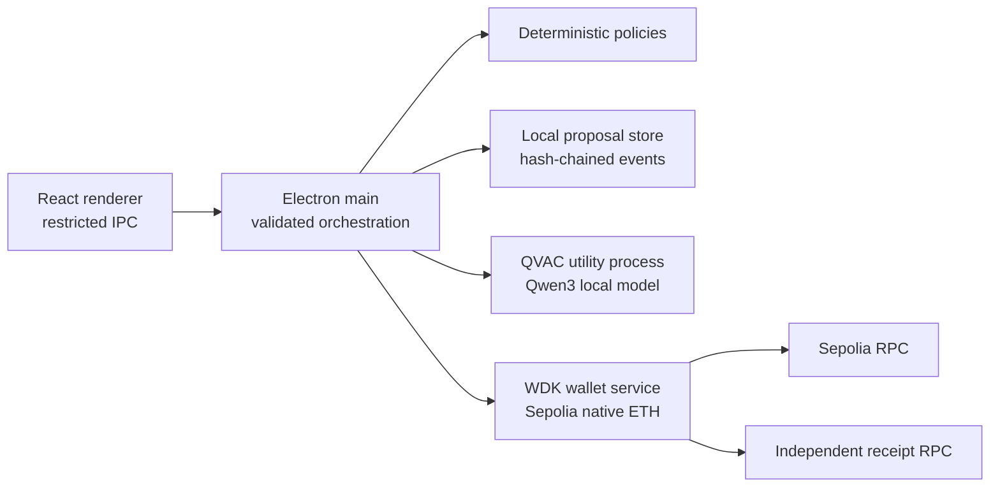

# ATG Pocket — Offline-First Stablecoin Treasury Guardian

**Private on-device explanations. Deterministic controls. Explicitly reviewed testnet payments.**

ATG Pocket is a self-custodial treasury assistant prototype for small businesses. It explores how businesses can understand treasury decisions, compare cross-border payment costs, and avoid unnecessary conversion and transfer fees while keeping sensitive context local.

The current prototype is deliberately narrower than that vision: it provides a synthetic KES policy example, locally persisted proposals and audit events, a QVAC-powered advisory copilot, and a separate native ETH wallet workflow on Ethereum Sepolia. It does not hold or settle business KES, USDT, or USDC. Sepolia ETH is valueless testnet currency. No live stablecoin liquidity, swaps, FX savings, production settlement, or cross-chain routing are implemented.

## Feature status

| Status | Capability | Evidence / limit |
|---|---|---|
| Implemented and tested | QVAC local explanation in an Electron utility process | Offline cache reuse demonstrated; output is advisory and can be slow or wrong. |
| Implemented and tested | Deterministic synthetic KES proposal policy | Integer minor units, fail-closed checks; no conversion or settlement. |
| Implemented and tested | Local proposal persistence and SHA-256 hash-chained audit verification | Local tamper evidence only, not a remote audit anchor. |
| Implemented and tested | Separate Sepolia native ETH policy and WDK workflow | Automated policy, lifecycle, security-boundary and storage checks exist. |
| Implemented and tested | Treasury cost-comparison planner | Uses only explicit user-entered data; default values are synthetic examples, never market quotes. |
| Implemented; real transaction not demonstrated | Sepolia wallet creation/recovery, quote, approval, OS confirmation, signing/broadcast lifecycle and independent receipt lookup | Automated checks are not a real transfer. **A real Sepolia transfer has not been completed and independently verified.** |
| Planned / unsupported | USDT/USDC market quotes, liquidity, swaps, FX routing, KES settlement, mainnet or production treasury execution | No provider, contracts, route, or production controls are configured. |

## Product and architecture

The desktop application uses Electron, React and TypeScript. The renderer is a restricted presentation layer; Electron main validates IPC and coordinates domain services. QVAC inference runs in an isolated utility process. The deterministic policy engine is independent of QVAC: model text cannot set amounts, authorize transfers, change policy, or bypass confirmation.



The local audit chain detects changes to retained history, but an owner of the machine can rewrite the whole file and recompute hashes. It is not encrypted-at-rest, remotely anchored, or proof that a payment happened.

### QVAC local copilot

- Application SDK: [`@qvac/sdk@0.22.0`](package.json); model catalog ID `QWEN3_600M_INST_Q4`.
- Model: Qwen3 600M Q4_0 GGUF, 382,156,480 bytes (about 365 MiB), from `unsloth/Qwen3-0.6B-GGUF`, revision `50968a4468ef4233ed78cd7c3de230dd1d61a56b`.
- SHA-256: `33bcc57074ec7b6eada5a90651ee546ec0c2b271002c22baf9f1b2dd1e8f75cb`. The pinned model repository identifies Apache-2.0; include its license and attribution with any redistributed weights. The SDK is separately licensed Apache-2.0.
- Invocation: [`qvac-worker.ts`](src/electron/qvac-worker.ts); utility-process lifecycle and protocol: [`main.ts`](src/electron/main.ts), [`qvac-protocol.ts`](src/electron/qvac-protocol.ts). The model cache is managed by QVAC under Electron user data.
- First initialization requires internet to obtain the model. Once cached, inference can run offline. Initialize the model once while connected before the offline demonstration; then disconnect networking and use **Generate explanation**. The recorded feasibility run separately confirmed cached inference in a network-isolated process; the packaged product’s offline behavior should be demonstrated on the submission device.
- Feasibility measurements on the tested Ubuntu device: online load 4.882 s / inference 8.007 s; isolated offline load 8.411 s / inference 12.911 s; measured QVAC process-tree peak RSS 523,911,168 bytes. Electron utility-process feasibility run: cached load 7.902 s / inference 7.068 s. These are individual runs, not performance guarantees. In a current UI smoke response, with KES 60,000 budget, KES 24,000 prior spending and KES 8,000 proposed purchase, the model incorrectly reported KES 46,000 remaining (the arithmetic is KES 28,000). The model also showed `<think>` leakage and ignored output constraints. Treat every answer as untrusted explanation, not financial logic.

### Wallet and transfer boundary

The wallet workflow supports **only native ETH on Ethereum Sepolia (chain ID 11155111)**. It uses `@tetherto/wdk@1.0.0-beta.22`, `@tetherto/wdk-wallet-evm@1.0.0-beta.24`, an explicit compatibility override for `@tetherto/wdk-wallet@1.0.0-beta.21`, and ethers 6.17.0. Core implementation: [`sepolia-wallet.ts`](src/electron/sepolia-wallet.ts), [`sepolia-domain.ts`](src/electron/sepolia-domain.ts), and [`transfer-store.ts`](src/electron/transfer-store.ts). See [official WDK documentation](https://docs.wdk.tether.io/).

The WDK service runs in Electron main. On Linux, setup requires GNOME Keyring (`gnome_libsecret`) and Electron async `safeStorage`; the 12-word recovery phrase is shown once in a separate restricted window. Only OS-encrypted phrase ciphertext is persisted. Decrypted seed material exists transiently in main-process memory and JavaScript strings cannot be reliably erased. Keep a separate demo wallet; loss of both device and phrase has no recovery path.

The synthetic KES policy and exact-wei Sepolia ETH test policy are separate. A Sepolia proposal receives fresh chain, balance and fee checks; eligible transfers need explicit approval when policy says so and a second OS confirmation. The service signs/broadcasts through WDK, records lifecycle states, treats ambiguous broadcast as unknown without retry, and checks a second RPC for receipt and native-transfer shape. Broadcast is not confirmation. The repository has **no independently verified real transfer**.

## Treasury cost planning

The planner accepts two or more explicitly entered route observations and compares their stated effective cost using the same source amount and a user-supplied reference rate. It computes `(source amount + source-denominated fee) × reference rate − net destination amount`, retaining negative values and ranking lower cost first. This is arithmetic over user input, not a quote, routing, or verification service. For a meaningful comparison, use the same source/destination assets, amount, timing, and fee assumptions; include spread and every known provider, network, and transfer fee consistently. Do not treat the result as executable or realized savings.

A live quote integration was not a safe fit for this alignment pass: [0x Swap API](https://docs.0x.org/docs/introduction/quickstart/swap-tokens-with-0x-swap-api) and the [Uniswap quote API](https://developers.uniswap.org/docs/api-reference/aggregator_quote) require API keys, while a useful comparison additionally needs verified chain/token contracts, liquidity availability, route-specific fee fields, and an independently documented baseline. No key or configured asset route is present. No addresses, liquidity, prices, or live quote claims are supplied by this app.

## Offline and online behavior

| Capability | Network needed? | Notes |
|---|---|---|
| QVAC inference after model cache is complete | No | First model download needs network. |
| Synthetic KES policy evaluation | No | Inputs and policy are local fixtures. |
| Proposal persistence and local audit verification | No | Stored in Electron user data. |
| Cost comparison of entered quote values | No | No quote source or market lookup. |
| Sepolia wallet setup / restore | Yes | Secure local keyring plus RPC chain identity check. |
| Balance refresh and fee estimate | Yes | Sepolia RPC; values can become stale immediately. |
| Signing and broadcast | Yes | Fresh network/policy checks and explicit user confirmation. |
| Receipt verification | Yes | Independent Sepolia RPC. Offline proposals are never broadcasts or settlements. |
| Future liquidity / FX lookup | Yes | Not implemented. |

## Tested device and requirements

Feasibility host: Ubuntu 26.04 LTS, x86_64; AMD Athlon Gold 3150U (2 cores / 4 threads), integrated Radeon Vega 3 Graphics, 20 GiB RAM and 8 GiB swap. Vulkan reported AMD RADV API 1.4.335. Feasibility tooling recorded Node.js 24.22.0, npm 12.2.0, g++ 15.2, and `libatomic1`; the initial app setup specified Node.js 22.17+ and npm 10.9+. Model fit estimated 8.025 GB remaining memory budget at the time of that probe. The separate offline run measured 523,911,168 bytes peak QVAC process-tree RSS. Host memory and timings vary. Ubuntu device/package values are feasibility notes, not a guarantee that another host is supported.

Linux wallet setup requires a graphical session and GNOME Keyring/libsecret configured for Electron `safeStorage`. Sepolia RPC access is required for every chain action. The QVAC model artifact license is Apache-2.0; review the model notice and retain attribution when distributing the weights.

## Install, run, verify

Requires Ubuntu desktop, Node.js 22.17+ and npm 10.9+ (tested feasibility host was newer).

On Linux, `npm run dev:electron` and `npm start` keep Chromium sandboxing enabled. Electron's bundled `chrome-sandbox` must be root-owned with mode `4755`. The launcher checks this before startup and prints the exact repair commands if the helper was unpacked with unsafe permissions. Reinstalling dependencies may reset the permissions.

```bash
npm ci
npm run dev:electron
```

`npm run dev` starts the renderer-only Vite preview; it does not include the Electron preload bridge. Before an offline AI demo, launch the app while connected, initialize the model, and wait for readiness. Then disconnect networking and request an explanation.

```bash
npm run typecheck
npm test
npm run build
npm start
```

`npm test` builds and runs the Node test suite, including policy, storage/audit, wallet lifecycle/security, and inference boundary tests. `npm audit` checks the installed dependency tree; see the dependency note below. `npm start` opens the last production build. The preserved smoke workspaces under `tools/feasibility/` are historical feasibility artifacts, not app runtime dependencies.

## Dependency audit

The root application dependency tree returned **zero findings** from `npm audit` during this alignment pass. The preserved standalone QVAC feasibility workspace has a separate historical lockfile and was previously reported with three high findings involving transitive `zod@4.6.5`; that workspace is not used by the application. Re-audit both trees before packaging if the smoke workspace is reused.

## What the team built and reused

Implemented in ATG Pocket: Electron security and IPC boundaries, QVAC adapter and advisory UI, deterministic KES example and Sepolia ETH policies, local proposal/audit persistence, wallet onboarding/backup boundary, transfer lifecycle and second-RPC receipt verification, and entered-quote comparison planner. Reused third-party dependencies include Electron, React, TypeScript, QVAC SDK/model, WDK, ethers and supporting packages. The pretrained Qwen3 model and vendor SDKs were not created by this team. The isolated QVAC and WDK feasibility harnesses were retained and informed the implementation. No external market-data provider is connected.

## Limitations and roadmap

Current demo policies and dashboard figures are synthetic. Sepolia ETH is test-only and does not represent stablecoin treasury value. Local audit chaining is not tamper-proof against a machine owner. Local records have no remote backup; wallet recovery depends on the user’s phrase. Wallet network actions rely on public RPCs and GNOME Keyring. No live stablecoin settlement, production safeguards, quote provider, FX engine, liquidity route, swap, bridge, or mainnet support exists.

Roadmap: establish asset and jurisdiction requirements; identify permitted quote providers and verified supported networks/contracts; compare indicative and executable quotes against a same-time, same-amount baseline with full spread, provider, network and transfer costs; add freshness and provenance controls; independently validate a test flow; only then consider any production scope.

## Demo and submission checklist

Judges can follow the step-by-step [offline run and demo guide](docs/submission/offline-judge-guide.md).

**Offline demonstration**

1. Install dependencies and run `npm run dev:electron` while online.
2. Initialize QVAC and wait until the model is ready.
3. Disconnect networking; generate an advisory explanation and show its latency/limitations.
4. Evaluate a synthetic KES proposal and verify local audit status.
5. Show the quote planner with clearly identified user-entered or synthetic data.

**Online wallet demonstration**

1. Confirm GNOME Keyring is available; create a dedicated Sepolia demo wallet and securely record its recovery phrase.
2. Fund it only with Sepolia test ETH from a source you independently verify.
3. Review recipient, amount, estimated fee, policy result, approval and OS confirmation.
4. If a transfer is actually made, verify its successful receipt and exact transfer shape through the independent RPC and explorer. Until those checks are recorded, report no completed/verified transfer.

**Before claiming a real Sepolia transfer:** perform a user-approved transfer from the dedicated test wallet, preserve the transaction hash, independently verify chain, successful receipt, sender, recipient and exact value, and capture reproducible evidence. No transaction was sent by this alignment work.

Repository: *(add repository URL when publicly available)*
Demo video: *(add only after a video exists)*
