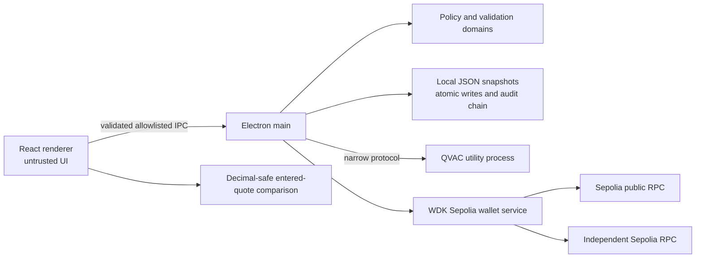

# ATG Pocket — Architecture and Current Boundaries

**Updated:** 2026-10-29. This document describes the repository as implemented; the original discovery record remains in [`feasibility.md`](feasibility.md).

## Product boundary

ATG Pocket is an offline-first stablecoin treasury guardian prototype. Implemented capabilities are a local advisory copilot, deterministic synthetic KES policy example, local proposal and audit records, a Sepolia mock USD₮ ERC-20 test wallet (with native ETH for gas), and a deterministic calculator for explicitly entered route quotes. The longer-term USDT/USDC liquidity and cross-border cost direction is not implemented. KES fixtures do not settle KES; Sepolia ETH is not a stablecoin balance.

## Runtime components

- **Renderer:** React/TypeScript; sandbox, context isolation, no Node integration, restrictive CSP, and a narrow typed preload. It cannot submit policy outcomes, direct signing requests, or secrets.
- **Electron main:** validates IPC caller and input, coordinates domain and persistence operations, and owns WDK and wallet secret handling.
- **QVAC:** `@qvac/sdk@0.22.0` runs from [`qvac-worker.ts`](../../src/electron/qvac-worker.ts) in Electron `utilityProcess` using a typed request protocol. Model ID is `QWEN3_600M_INST_Q4`, Qwen3 600M Q4_0. Initialization may download/cache weights; inference can then run locally. Output is advisory and never an input to policy or transaction authorization.
- **Deterministic policy:** [`treasury-domain.ts`](../../src/electron/treasury-domain.ts) uses exact integer minor units for the synthetic KES demonstration. [`sepolia-domain.ts`](../../src/electron/sepolia-domain.ts) checks six-decimal mock USD₮ transfer amounts and ETH-denominated gas policy for Sepolia. This test-token workflow is not a business stablecoin integration.
- **Persistence/audit:** main-process stores use versioned JSON, atomic replacement, exact schema validation and SHA-256 hash-chained events. Chaining detects local retained-history edits, but cannot prevent a machine owner from rewriting the entire file and recomputing hashes. No remote anchor, encryption-at-rest, or remote backup is provided.
- **WDK:** `@tetherto/wdk@1.0.0-beta.22`, `@tetherto/wdk-wallet-evm@1.0.0-beta.24`, compatibility-pinned `@tetherto/wdk-wallet@1.0.0-beta.21`, and ethers 6.17.0 implement a Sepolia test USD₮ ERC-20 workflow; native Sepolia ETH is used only for gas. See [`sepolia-wallet.ts`](../../src/electron/sepolia-wallet.ts).
- **Cost planner:** [`treasury-cost.ts`](../../src/electron/treasury-cost.ts) compares at least two explicit user-entered quotes with fixed decimal precision. It has no network access or quote source.

## Wallet boundary and lifecycle

Wallet setup checks Sepolia chain identity and Electron asynchronous `safeStorage`. On Linux the selected backend must be GNOME Keyring (`gnome_libsecret`). A dedicated restricted backup window displays a 12-word phrase once; only OS-encrypted phrase ciphertext is stored. Decrypted seed text exists transiently in main-process memory, where JavaScript strings cannot be reliably erased. No phrase/private key enters the main renderer, proposal store, logs, or ordinary IPC.

The user creates a quote, may explicitly approve a policy threshold, then separately confirms a test USD₮ ERC-20 transaction in an OS dialog. Main rechecks chain, balance, exact amount, fee and policy before WDK signing and broadcast. An ambiguous broadcast becomes `unknown` and is never automatically retried. A second RPC checks chain, successful receipt, transaction hash, sender/recipient validity and native transfer shape before the record can be marked confirmed. Network is required for setup, balance, fees, signing/broadcast and receipt checks. Broadcast alone does not mean confirmed.

Automated lifecycle/security tests and RPC-independent domain tests pass when run, but **a real transfer has not been completed and independently verified**.

## Offline behavior

After model download/cache, QVAC inference, synthetic policy evaluation, local storage/audit verification and entered-quote arithmetic run without network. Initial model download and every Sepolia wallet operation require internet. An offline proposal is never represented as broadcast or settled. No liquidity or FX lookup exists.

## Feasibility evidence

The host, QVAC model revision/checksum/license, model and inference timings, measured memory, and the historical investigation of WDK/provider constraints are recorded in [`feasibility.md`](feasibility.md). Those are measurements for the tested Ubuntu machine, not broad performance guarantees. The original `tools/feasibility/` workspaces remain preserved as evidence and are not imported by application runtime.

## Quote and FX direction

No live source is configured. 0x and Uniswap APIs document API-key requirements; supporting a real route would also require verified chain/token identity, current route liquidity, provider fee/spread treatment, network costs, quote timestamps/expiry, and a same-source-amount / same-destination-amount or reference-rate baseline. An indicative price is not an executable order; neither is a completed transaction. The current planner accepts manual figures and labels its arithmetic as illustrative. It must not be described as live market data or achieved savings.

## Reproduction

From the repository root: `npm ci`, `npm run dev:electron`; run `npm run typecheck`, `npm test`, and `npm run build` for verification. For offline QVAC demonstration, initialize once online, wait for readiness, disconnect networking, and request an explanation. GNOME Keyring is needed for wallet setup; all chain operations need Sepolia RPC connectivity. See the root README for the full checklist.
